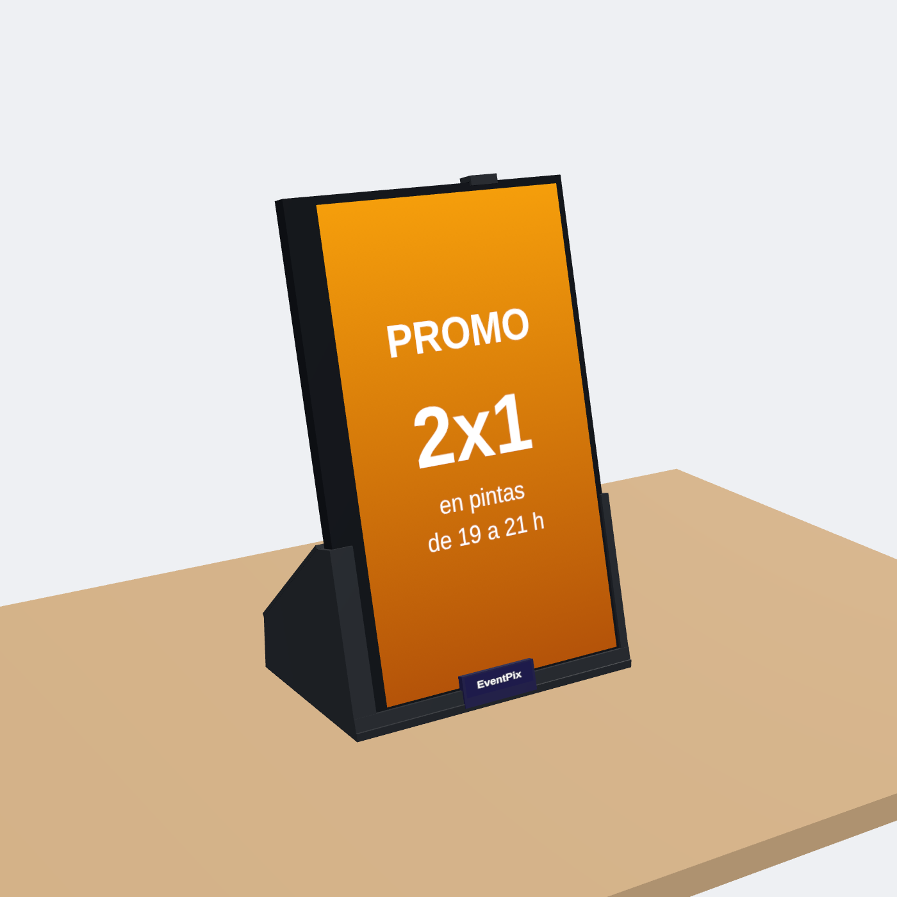
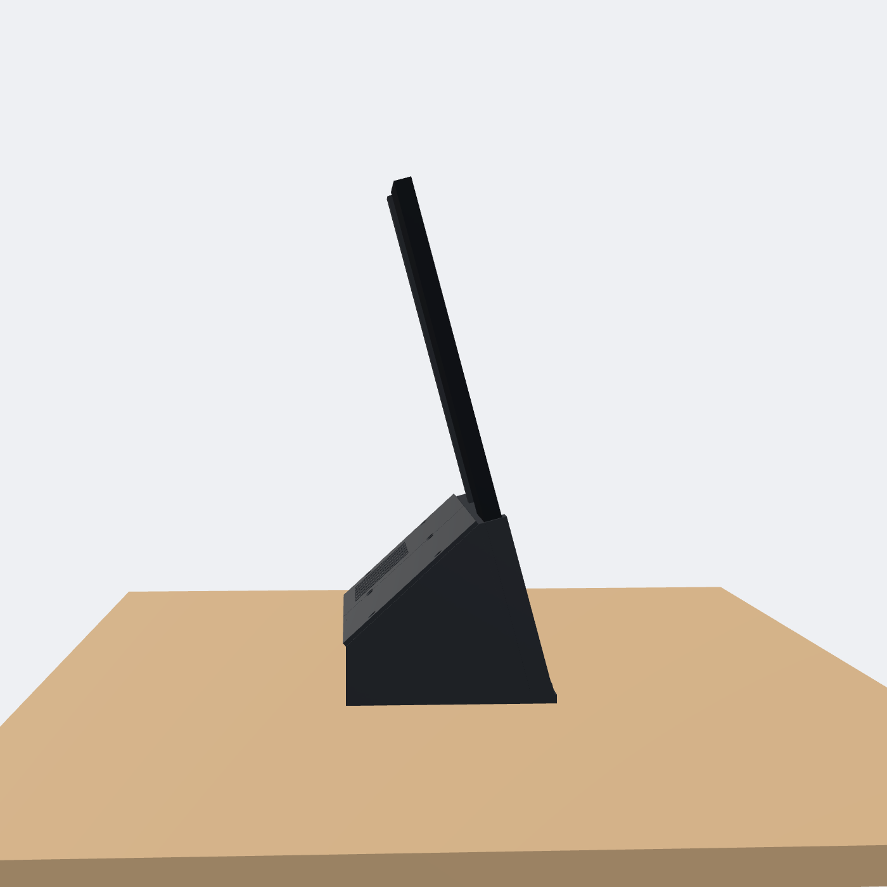
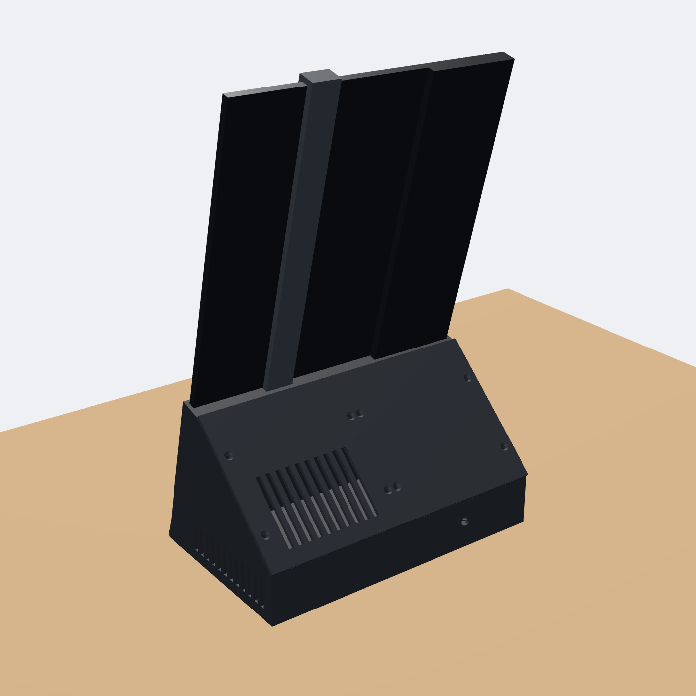
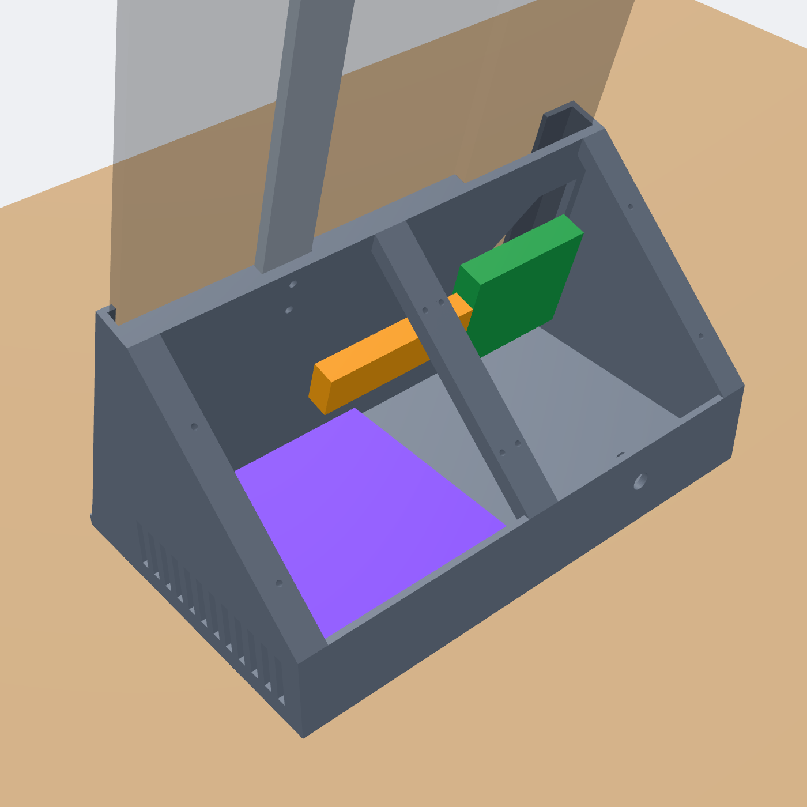
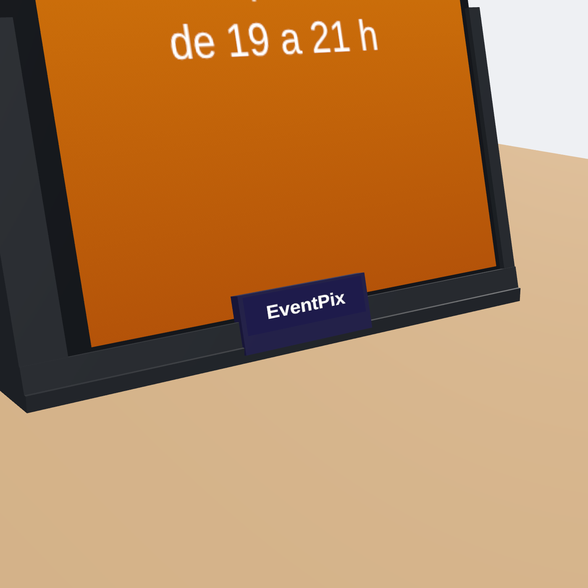

# Exhibidor de mostrador (v3)

Pantalla de mostrador para Display Digital: monitor portátil X-micro 15,6" (X16F-PTB156E)
en vertical, con el TV box Tanix W2 y la plaquita del HDMI adentro de un pie impreso en 3D
que queda **detrás** del monitor.



- Medidas: 231 mm de ancho × 142 mm de fondo. Pie de 12,7 cm de alto; total ~35 cm.
- Monitor inclinado 15°, casi apoyado en la mesa.
- Agarre: tope abajo de 4,5 mm (sobre el marco, sin tapar la imagen), costados con labio
  que suben 12 cm y traba arriba del monitor.
- Antirrobo: el pie se atornilla a la mesa **desde adentro** y la traba se atornilla desde
  adentro del pie. Para sacar algo hay que abrir el techo (8 tornillos, mejor antivandálicos).
- Mirando la pantalla de frente, la franja gruesa del monitor (la de la marca) queda a la
  **izquierda**. Probado con las esquinas de prueba.

| | |
|---|---|
|  |  |
|  |  |

Por dentro: Tanix en violeta, plaquita HDMI en verde, ficha HDMI en naranja.

## Piezas (`stl/`)

Todas entran en una cama de 220 × 220 mm y se imprimen **sin soportes**, en la posición en
que vienen los archivos.

| Archivo | Posición en la cama |
|---|---|
| `lado_izquierdo.stl`, `lado_derecho.stl` | Parados sobre el piso del pie (la cara que apoya en la mesa) |
| `costilla_central.stl` | Acostada |
| `techo_izquierdo.stl`, `techo_derecho.stl` | Planas |
| `traba_superior.stl` | Acostada sobre la espalda, en diagonal |
| `pestana_logo.stl` | Con el frente sobre la cama (sale liso para el DTF) |
| `tapa_marca_costado.stl` | Plana (la cara de la cama queda a la vista) |
| `prueba_esquina_izquierda.stl`, `prueba_esquina_derecha.stl` | Para probar el encastre antes de imprimir todo |

## Impresión (Cura, boquilla 0,8, impresora Bowden)

| Ajuste | Valor |
|---|---|
| Material | PETG, ~600 g |
| Altura de capa | 0,3 mm |
| Ancho de línea | 0,8 mm (tamaño de tobera 0,8 en la máquina) |
| Paredes | 3 líneas (2,4 mm) |
| Capas superiores / inferiores | 4 / 3 |
| Relleno | 20 % gyroid |
| Temperatura | 240 °C (rango del rollo 225–245) / cama 70 °C |
| Ventilador | 40 % (máx. 50 %), 0 % en la primera capa |
| Velocidad | 60–70 mm/s; pared exterior 40 mm/s; primera capa 20–25 mm/s |
| Retracción | 5 mm a 40 mm/s (Bowden) |
| Soportes | Desactivados |
| Adherencia | Borde (brim) de 5 mm |

Sobre vidrio: barra adhesiva como separador y despegar en frío. El PETG pegado al vidrio
limpio puede arrancar pedacitos.

Después de imprimir, repasar agujeros: 2,5 mm (guías), 3,5 mm (pasantes), 4,5 mm (mesa).

## Lista de compras

**Tornillos (12):**

| Dónde | Cant. | Tipo | Medida | Cabeza |
|---|---|---|---|---|
| Tapas del techo | 8 | Autorroscante para plástico | 3 × 10 mm | Fresada. Mejor Torx antivandálico (punta T10 con agujero) |
| Traba superior (desde adentro) | 2 | Autorroscante para plástico | **3 × 8 mm**, no más largo (la punta tocaría el monitor) | Redonda o lenteja |
| Fijación a la mesa (desde adentro) | 2 | Para madera | 4 × 20 mm (mesada de 18 mm) o 4 × 25 | Redonda o fresada, hasta 9 mm de diámetro |

En mesada de piedra o vidrio: doble faz VHB 3M bajo el piso, o tarugos de 5 mm.

**Electricidad (una sola fuente para el Tanix y el monitor, los dos de 5 V):**

| Qué | Detalle |
|---|---|
| **Fuente switching 5 V 3 A** | Ficha 5,5 × 2,1 mm. **Probada** en el primer exhibidor (ver abajo). Con 2 A no alcanza: se reinicia. |
| Jack hembra de chasis 5,5 × 2,1 | Con rosca de 8 mm (DC-099); el agujero de atrás es de 8 mm |
| Módulo USB-A hembra + cable USB-A → USB-C de 20–30 cm | Para el monitor. No conectar 5 V directo a un USB-C: muchos monitores no prenden sin la resistencia que traen esos cables. |
| Ficha DC para el Tanix | La de su fuente original, cortada (confirmar que sea de 5 V). **Que quede firme**: un falso contacto en la ficha da los mismos apagones que una fuente floja. |
| Empalmes Wago 221 (2 de 3 vías), cable **20 AWG o más grueso**, corto, termocontraíble | |
| Multímetro | Verificar 5 V y polaridad antes de conectar, y medir con todo andando |

```
Fuente 5V 3A ──> jack (atrás) ──> Wago (+/–) ──┬──> ficha DC ──> Tanix
                                              └──> módulo USB-A ──> cable USB-A→C ──> plaquita del monitor
```

**Prueba del primer exhibidor (fuente 5 V 3 A, Tanix W2 + monitor X-micro):**
- Consumo estimado: Tanix ~1 A (picos ~1,4 A); monitor ~1,2–1,5 A con brillo medio, ~2 A al máximo.
- Con brillo al 80 %: entre 4,98 V (picos) y 5,08 V, sin reinicios. Con el brillo más bajo: 5,20 V.
- Rango correcto: **4,75 V a 5,25 V**. Medir en el jack con un video corriendo: si baja de
  4,9 V la fuente se queda corta; si pasa de 5,3 V, la fuente está fallada.
- El brillo se cambia desde el **menú del monitor** (ruedita MENU). Si no deja, apagar ECO,
  DCR (contraste dinámico) o HDR. Más bajo encandila menos y deja más margen a la fuente.

**Si no se consigue fuente de 5 V 3 A:** fuente de **12 V 2–3 A** (las de routers o
cámaras) más un conversor reductor adentro, ajustado a **5,1 V con el multímetro antes de
conectar nada**:
- **XL4015 5 A**: uno solo alcanza para los dos equipos.
- **LM2596 (o LM2596HVS)**: aguanta ~2 A continuos, así que van **dos**, uno para el Tanix y
  otro para el monitor, con las entradas en paralelo al jack.
- Ojo: ese exhibidor queda con jack de **12 V** (marcarlo).

**Que siga andando sin luz (opcional):** un "mini UPS para router" **afuera**, entre el
enchufe y el exhibidor. No poner baterías de litio adentro del pie (calor y encierro).

**Patitas:** 4 topes de silicona autoadhesivos de 10–12 mm, en las esquinas a 1,5 cm de los
bordes. Si va atornillado a la mesa, no apretar a fondo.

**Varios:** PETG 1 kg, barra adhesiva, epoxi o La Gotita gel, cinta doble faz espumada de 1 mm
(respaldo y tope), VHB (pestaña y tapita), silicona caliente (plaquita y módulo USB),
precintos, minitorno o cutter, DTF con el logo y un control "air mouse" 2.4G con receptor
USB (el Tanix queda adentro y el control infrarrojo no llega).

## Armado

1. **Monitor:** en la tapa de atrás, sobre la franja gruesa, abrir una ventana de ~5 × 7 cm
   entre 1,5 y 9,5 cm desde el borde de abajo (coincide con la ventana del pie). Soltar las
   cintas de la plaquita HDMI y sacarlas por ahí.
2. Pegar `lado_izquierdo` + `costilla_central` + `lado_derecho`.
3. Atornillar el pie a la mesa con los 2 tornillos, desde adentro. Uno queda debajo del
   Tanix: ponerlo antes.
4. Bajar el monitor desde arriba, entre los costados. Pasar las cintas por la ventana del
   pie, conectarlas a la plaquita y pegarla por dentro, sobre el respaldo, con el HDMI
   hacia la derecha.
5. Tanix acostado a la derecha, con el HDMI mirando a la izquierda. El cable sobrante se
   enrolla en vueltas de 8 cm o más.
6. Jack atrás y alimentación según el esquema. Antes de cerrar, medir el voltaje con un
   video corriendo y el brillo que va a usar (tiene que dar 4,9 V o más).
7. Traba superior: engancharla arriba del monitor y atornillarla desde adentro (2 × 3 × 8 mm).
8. Techo: 8 tornillos.
9. Pestaña: aplicar el DTF y pegarla al centro, sobre el tope de abajo. Tapa ~1 cm de imagen
   abajo al centro.
10. Tapita de marca (opcional): sobre el "X-MICRO" del costado.

En el Tanix: salida 1080p 60 Hz, color 8 bits, HDR apagado. En el panel: pantalla en Vertical.

## Regenerar las piezas

Los STL salen de `generador/exhibidor.py` (todas las piezas menos la pestaña y la tapita) y
`generador/pestana.py` (esas dos). Las medidas son parámetros al principio del archivo
(juego del encastre, inclinación, alto del tope, etc.).

```bash
python3 -m venv .venv && .venv/bin/pip install manifold3d==3.1.1 trimesh==4.5.3 numpy scipy
.venv/bin/python generador/exhibidor.py '{"fit": 0.4}'   # escribe en stl/
.venv/bin/python generador/pestana.py
```

El generador también verifica que no haya choques entre el monitor, el pie, la traba, el
techo, el Tanix y la plaquita (todo tiene que dar 0).
